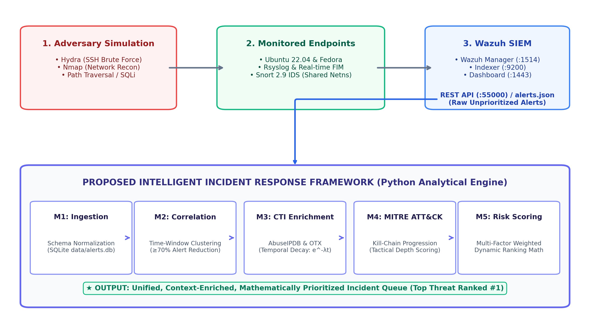

# Open-RBA: Risk-Based Alerting & Incident Prioritization Framework

**Academic Title:** *Intelligent Incident Response Framework using Threat Intelligence Enrichment and Risk-Based Incident Prioritization for SIEM Environments*  

---

## 📌 Overview
`open-rba` is an open-source, deterministic Python framework designed to eliminate SIEM alert fatigue by converting raw, statically-severitized alerts from **Wazuh SIEM** into mathematically prioritized, context-enriched incidents.



## 🏗️ 5-Stage Pipeline Architecture

```text
Raw Wazuh Alerts (JSON / API :55000)
                  │
                  ▼
┌──────────────────────────────────────┐
│  Module 1: Ingestion & Normalizer    │ ── SHA-256 Content-Hash Deduplication & SQLite Schema
└──────────────────┬───────────────────┘
                  │
                  ▼
┌──────────────────────────────────────┐
│  Module 2: Temporal Correlation      │ ── Session-Window Burst Compression (≥70% Noise Cut)
└──────────────────┬───────────────────┘
                  │
                  ▼
┌──────────────────────────────────────┐
│  Module 3: CTI Enrichment & Decay    │ ── AbuseIPDB with Exponential Decay (e^-λΔt)
└──────────────────┬───────────────────┘
                  │
                  ▼
┌──────────────────────────────────────┐
│  Module 4: MITRE ATT&CK Mapper       │ ── Kill-Chain Tactical Depth Progression [0.1 to 1.0]
└──────────────────┬───────────────────┘
                  │
                  ▼
┌──────────────────────────────────────┐
│  Module 5: Dynamic Risk Scorer       │ ── Normalized Multi-Factor Risk & Entity Aggregation
└──────────────────┬───────────────────┘
                  │
                  ▼
Prioritized Analyst Incident Queue & Entity Rollup
```

1. **Module 1 (Ingestion & Normalization):** Ingests raw alerts via Wazuh REST API (`:55000`) or log files into standardized SQLite schema with deterministic SHA-256 content-hash deduplication.
2. **Module 2 (Temporal Correlation):** Clusters high-frequency alert bursts sharing `(src_ip, target_host, technique_family)` within session windows to eliminate alert storms.
3. **Module 3 (Threat Intel with Decay):** Enriches indicators with AbuseIPDB confidence scores and applies exponential temporal decay ($e^{-\lambda \Delta t}$) with local SQLite caching.
4. **Module 4 (MITRE ATT&CK Mapping):** Maps technique IDs and behavioral signatures to MITRE tactics, calculating chronological kill-chain progression depth.
5. **Module 5 (Dynamic Multi-Factor Risk Scoring):** Computes normalized multi-factor risk:
   $$R_{base} = w_{sev} \cdot S_{norm} + w_{cti} \cdot CTI_{decay} + w_{kc} \cdot KC_{norm} \in [0.0, 1.0]$$
   $$R_{incident} = R_{base} \cdot M_{asset} \in [0.0, 3.0]$$
   $$R_{entity} = \left(\sum R_{incident}\right) \cdot \text{Tactics\_Depth\_Bonus}$$

---

## 📁 Repository Structure
```
open-rba/
├── config/             # Configurable weights (weights.yaml)
├── data/               # SQLite database & local caches (sample_alerts.json, alerts.db)
├── docs/               # Formal M.Tech proposal, presentation & diagrams
├── src/                # Modular Python source code (M1 to M5)
│   ├── ingestion/      # Module 1: Ingestion, schema, deduplication & Wazuh client
│   ├── correlation/    # Module 2: Session-window temporal correlation engine
│   ├── enrichment/     # Module 3: Threat intelligence client with exponential decay
│   ├── attck/          # Module 4: MITRE ATT&CK tactical depth mapper
│   ├── scoring/        # Module 5: Multi-factor risk scoring & entity aggregation
│   └── pipeline.py     # End-to-end analytical pipeline CLI
└── tests/              # Complete Pytest test suite (62 test cases)
```

---

## 🚀 Quickstart & Usage

### 1. Run the Complete Analytical Pipeline
```bash
# Ingest alerts, correlate bursts, enrich CTI, map MITRE tactics, and prioritize:
python -m src.pipeline --file data/sample_alerts.json
```

### 2. Run the Ingestion Client Standalone
```bash
# Ingest from local alert JSONL file:
python -m src.ingestion.wazuh_client --file data/sample_alerts.json

# Ingest live alerts from Wazuh REST API:
python -m src.ingestion.wazuh_client --api --last 100
```

### 3. Run the Pytest Test Suite
```bash
pytest tests/ -v
```
*(All 62 unit and integration tests execute in <0.3s)*
